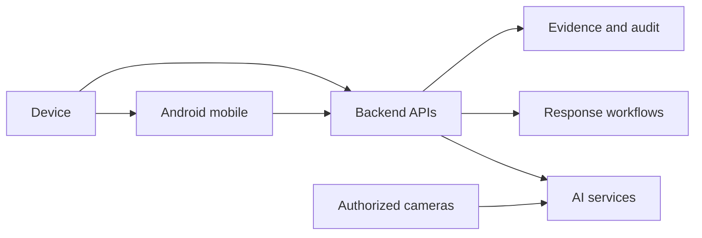
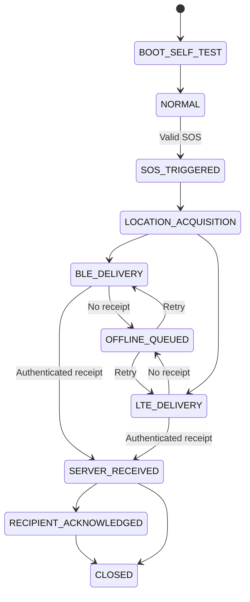

# Shakti Architecture

This document describes the proposed architecture for the Shakti unified
women's-safety platform. It is a design reference, not a completed system.

## Architecture Goals

| Goal | Design response |
|---|---|
| Fast activation | Physical button, long-press protection, immediate haptics |
| Outage resilience | Durable local incident queue and retry with backoff |
| Delivery confidence | Independent channels and explicit acknowledgement states |
| Privacy | Consent, least data, access control, retention |
| Responsible automation | AI candidates followed by human review |
| Traceability | Incident IDs, sequence numbers, evidence hashes, audit events |

## Logical Layers

| Layer | Responsibilities |
|---|---|
| Device | Button, haptics, BLE, battery, optional LTE/GNSS |
| Mobile | Pairing, account, contacts, location, permissions, status |
| Backend | Authentication, incidents, delivery, acknowledgements, audit |
| AI | Candidate personal-safety and camera signals |
| Response | Contacts, operators, and approved agency procedures |
| Evidence | Protected media, metadata, hashes, and retention |

## Incident State Machine

`SERVER_RECEIVED` means that the backend accepted the message. It does not
mean that a person read it or that an agency dispatched a response.

## Reliability Rules

1. Persist the incident before transmission.
2. Use a unique incident ID and monotonically increasing device sequence.
3. Make retries idempotent and deduplicate by incident ID.
4. Reserve queue capacity for unresolved emergencies.
5. Do not silently discard active incidents.
6. Label location source, accuracy, timestamp, and age.
7. Never claim a recipient was notified without a receiving acknowledgement.
