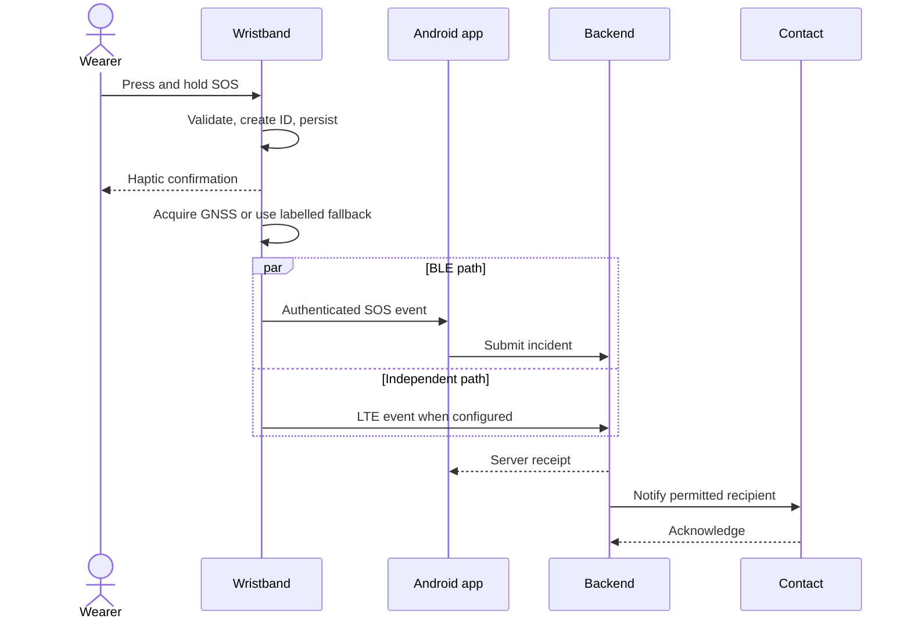
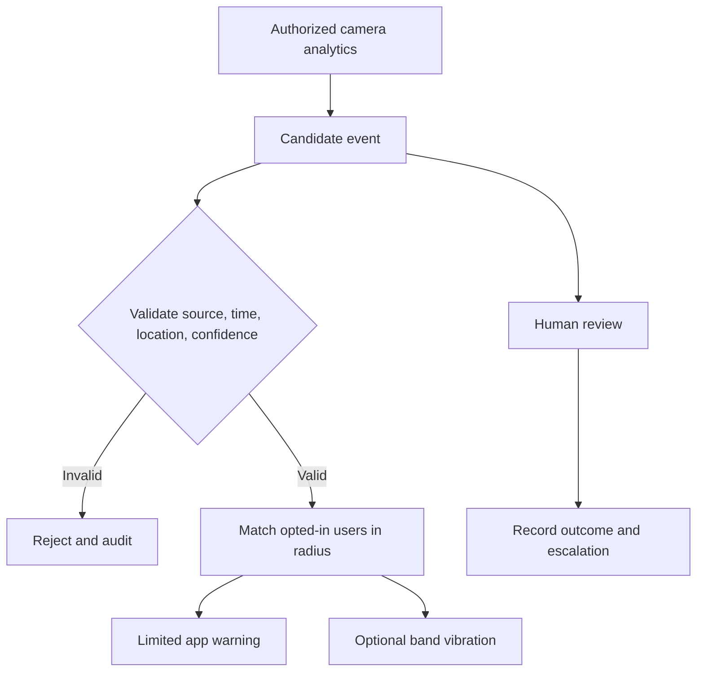

# Shakti Design and Workflows

## User Experience

The wearer should always understand what happened and what has not happened.

| Status shown | Meaning |
|---|---|
| Saved locally | The device recorded the incident, but no remote receiver confirmed it |
| Sending | One or more configured delivery paths are being attempted |
| Server received | The backend accepted and authenticated the incident |
| Recipient acknowledged | A permitted person or service confirmed receipt |
| Closed | The incident lifecycle ended with an audit record |

## Manual SOS Workflow

If all remote paths fail, the device keeps the event in its offline queue and
reports that delivery is pending.

## Communication Paths

| Path | Purpose | Dependency |
|---|---|---|
| BLE | Wristband to nearby phone | Paired, powered phone in range |
| LTE | Independent wearable-to-backend delivery | Modem, SIM/eSIM, operator coverage |
| GNSS | Independent location | Satellite visibility; no internet required |
| Local relay | Site or community transport | Deployed gateway and backhaul |
| Satellite | Optional remote fallback | Modem, service, antenna, power, sky view |

No path provides universal coverage. The fallback order should consider battery,
region, available networks, and user policy.

## Camera Warning Workflow

Camera analytics generate candidates, not proof of a crime or a person's
identity. Consequential actions require authorized human review.

## Evidence Workflow

1. Capture only with permission and policy approval.
2. Record incident, device, timing, location quality, and software metadata.
3. Encrypt locally where feasible.
4. Calculate a SHA-256 digest.
5. Upload through authenticated encrypted transport.
6. Verify and store in private object storage.
7. Audit access, export, review, and deletion.
8. Apply retention and controlled-disclosure policy.

A hash detects later file changes; it does not independently prove authenticity,
timing, ownership, or legal admissibility.
