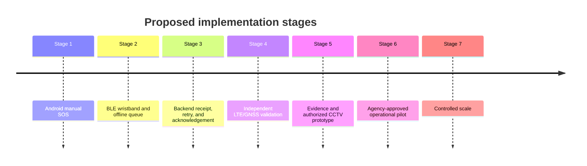

# Shakti Implementation Blueprint

> The interfaces and technologies below are proposed design examples. They are
> not deployed endpoints or proof of implementation.

## Technology Stack

| Area | Proposed technology |
|---|---|
| Android | Kotlin, BLE, location, notifications |
| Wearable | ESP32-class controller, persistent storage, haptics |
| Connectivity | LTE/GNSS modules; optional relay or satellite |
| Backend | Node.js, Express, PostgreSQL, Prisma |
| AI | Python services separated from the incident API |
| Notifications | Firebase Cloud Messaging or equivalent |
| Evidence | Private object storage and encrypted transport |

## Core Data Model

| Entity | Important fields |
|---|---|
| User | `id`, account status, consent, language, creation time |
| Device | `id`, user, hardware, firmware, public key, last seen, status |
| Incident | `id`, source, severity, status, creation time, location |
| LocationFix | Incident, coordinates, accuracy, timestamp, source, age |
| DeliveryAttempt | Incident, channel, destination, result, provider reference |
| Acknowledgement | Incident, actor, time, acknowledgement type |
| CameraEvent | Camera, event type, confidence, time, evidence, review status |
| EvidenceObject | Incident, storage key, algorithm, digest, retention |
| AuditEvent | Actor, action, target, time, outcome |

## API Responsibilities

| Method and route | Responsibility |
|---|---|
| `POST /api/v1/incidents` | Create an authenticated incident |
| `GET /api/v1/incidents/{id}` | Read permitted incident status |
| `POST /api/v1/incidents/{id}/acknowledgements` | Record acknowledgement |
| `POST /api/v1/devices/{id}/events` | Ingest wearable event |
| `POST /api/v1/camera-events` | Ingest authorized camera candidate |
| `POST /api/v1/delivery-attempts` | Record channel result |
| `POST /api/v1/evidence/manifest` | Register evidence metadata and digest |
| `GET /api/v1/nearby-alerts` | Return permitted nearby warnings |

All endpoints require authentication, validation, authorization, rate limiting,
idempotency, and versioning.

## Firmware Modules

| Module | Responsibility |
|---|---|
| SOS manager | Debounce, long press, cancellation, incident creation |
| State manager | Boot, normal, emergency, low battery, offline, recovery |
| BLE service | Pairing, GATT, framing, reconnects |
| Cellular manager | Power, SIM, registration, retries, responses |
| GNSS manager | Fix acquisition, quality, time, stale-location checks |
| Offline queue | Durable writes, sequence, retry, duplicate suppression |
| Power and haptics | Sleep, rails, battery, thermal checks, feedback |
| Security and diagnostics | Keys, watchdog, fault codes, reset reasons |

## Delivery Roadmap

## Validation Metrics

| Area | Measurements |
|---|---|
| Delivery | Receipt latency, retry success, duplicate rate |
| Location | Fix time, accuracy, age, stale-location rate |
| Power | Standby, BLE, GNSS, LTE peak, haptic energy |
| AI | Precision, recall, false alerts, missed events, calibration |
| Operations | Acknowledgement latency, escalation rate, audit completeness |

The basic manual SOS, offline queue, delivery state, and acknowledgement path
must be reliable before advanced AI or agency integrations are introduced.
