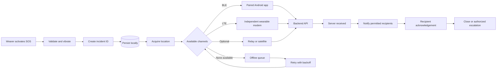
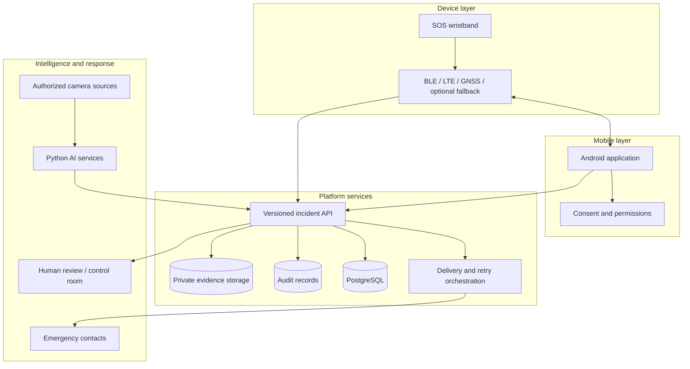

# Shakti

## Unified Women's Safety Platform

> **Project status:** Conceptual architecture and implementation blueprint  
> **Reference:** Unified Women's Safety technical blueprint, version 2.0  
> **Scope:** Documentation and theoretical design only

Shakti is a proposed end-to-end personal safety platform that combines an
Android application, a smart SOS wristband, offline-first incident handling,
independent communication, location services, authorized CCTV analytics, and
human-reviewed response workflows.

It is designed to answer the complete emergency question:

> **How do we detect a possible emergency, preserve it reliably, deliver it
> through the best available channel, confirm who received it, and keep an
> accountable record?**

## Contents

- [What Shakti Does](#what-shakti-does)
- [Platform at a Glance](#platform-at-a-glance)
- [Core Workflow](#core-workflow)
- [Feature Scope](#feature-scope)
- [Proposed Technology](#proposed-technology)
- [Architecture](#architecture)
- [Project Documentation](#project-documentation)
- [Important Boundaries](#important-boundaries)

## What Shakti Does

When a wearer activates SOS, Shakti is intended to:

1. Validate the action and provide immediate local haptic feedback.
2. Create a unique incident and save it before attempting transmission.
3. Acquire the best available location, including accuracy and age.
4. Try configured channels such as BLE, LTE, and optional fallback transports.
5. Retry undelivered incidents when connectivity returns.
6. Track backend receipt separately from human acknowledgement.
7. Escalate unanswered incidents through an authorized procedure.
8. Preserve permitted evidence with access control, hashes, and audit history.

The platform does **not** treat a notification being sent as proof that a
contact, control room, police service, or emergency agency received it.

## Platform at a Glance

| Layer | Responsibility | Primary capability |
|---|---|---|
| Android app | User interaction and permissions | SOS, contacts, location, status |
| SOS wristband | Fast local activation | Button, haptics, BLE, offline queue |
| Communication | Delivery resilience | BLE, LTE, GNSS, optional relay/satellite |
| Backend | Incident coordination | APIs, retries, acknowledgements, audit |
| AI services | Candidate signal generation | Personal-safety and CCTV analysis |
| Response | Human and agency workflow | Review, warning, escalation |
| Evidence | Traceability | Protected storage, hashes, retention |

## Core Workflow

## Feature Scope

| Area | Initial concept | Later or advanced scope |
|---|---|---|
| Android | Account, contacts, manual SOS, location, incident status, BLE pairing | Voice commands, distress detection, nearby warnings |
| Wristband | SOS button, haptics, BLE, battery status, offline queue | Independent LTE/GNSS, satellite, IMU |
| Backend | Users, devices, incidents, delivery, acknowledgements, audit | Camera correlation, escalation, partner integrations |
| CCTV AI | Authorized recorded footage, person detection, tracking | Temporal behaviour models and live operations |
| Evidence | Metadata, private storage, hashes, access logs | Signed manifests and formal chain of custody |
| Emergency services | User-directed calling and approved contacts | Formal agency integration after authorization |

The recommended approach is to make the manual SOS and acknowledgement path
reliable before adding sophisticated AI.

## Proposed Technology

| Component | Proposed direction |
|---|---|
| Mobile | Android, Kotlin, BLE, location, notifications |
| Wearable | ESP32-class controller, BLE, persistent storage, haptics |
| Connectivity | LTE/GNSS modules; optional relay or satellite accessory |
| Backend | Node.js, Express, PostgreSQL, Prisma |
| AI workloads | Python services isolated from the incident API |
| Push notifications | Firebase Cloud Messaging or equivalent |
| Evidence | Private object storage with encrypted transport |

These are candidate technologies for a future implementation, not evidence that
the system has already been built.

## Architecture

### Key design principles

- **Persist first:** save the event before any network attempt.
- **Offline first:** retain useful local behaviour during outages.
- **Idempotent retries:** reuse the incident ID to prevent duplicates.
- **Honest status:** server receipt, recipient acknowledgement, and closure are
  different states.
- **Privacy by design:** collect only necessary, consented data.
- **Human oversight:** AI produces candidate events; authorized people review
  consequential actions.
- **Replaceable transports:** no single communication path is assumed to be
  universally available.

## Project Documentation

| Document | Description |
|---|---|
| [Architecture](ARCHITECTURE.md) | Layers, incident state machine, data flow, and reliability rules |
| [Design and Workflows](DESIGN_AND_WORKFLOWS.md) | User experience, SOS, BLE, camera, evidence, and hardware workflows |
| [Implementation Blueprint](IMPLEMENTATION_BLUEPRINT.md) | Technology, data model, API responsibilities, roadmap, and validation |
| [Security and Privacy](SECURITY_PRIVACY.md) | Security controls, privacy rules, responsible AI, and evidence integrity |

## Important Boundaries

This repository does not contain a working application, firmware, AI model,
live CCTV integration, satellite service, police API, or emergency dispatch
integration.

The concept does not guarantee communication when all networks and relays are
unavailable. Camera AI is not proof that a crime occurred. A prototype bill of
materials is not a certified production design. Any real deployment requires
engineering validation, security testing, hardware certification, privacy and
legal review, service agreements, and controlled operational pilots.

## License and Usage

This repository currently serves as a project-planning and architecture
reference. Implementation, licensing, and deployment terms must be defined
before production development begins.
